<p align="center">
  
</p>

<p align="center">
  <a href="https://github.com/ishandutta2007/Awesome-Awesome-Awesome"></a>
  <a href="https://discord.gg/jc4xtF58Ve"></a>
  <a href="https://github.com/ishandutta2007/Awesome-Vector-Similarity-Search/stargazers"></a>
  <a href="https://github.com/ishandutta2007/Awesome-Vector-Similarity-Search/network/members"></a>
  <a href="https://github.com/ishandutta2007/Awesome-Vector-Similarity-Search/pulls"></a>
  <a href="https://github.com/ishandutta2007/Awesome-Vector-Similarity-Search/blob/main/LICENSE"></a>
  <a href="https://github.com/ishandutta2007"></a>
</p>

---

# 🚀 Awesome Vector Similarity Search

> **A curated showcase of top SaaS platforms, managed vector engines, and open-source vector similarity search projects.**  
> *Targeted at Vector Databases, Approximate Nearest Neighbor (ANN) Indexing, High-Dimensional Embedding Stores, Retrieval-Augmented Generation (RAG), and Real-Time Semantic Similarity.*

**Last Updated:** October 2026 📅  

---

<!-- SEO & Metadata Overview -->
## 📌 Overview & Core Concepts

**Vector Similarity Search** is the foundational database and retrieval primitive of the modern Artificial Intelligence and Large Language Model (LLM) stack. Unlike traditional relational or lexical inverted indexes that match exact keywords, vector search algorithms index mathematical dense vectors (embeddings) generated by neural networks (e.g., OpenAI text-embedding-3, BERT, CLIP, Cohere, BGE, Voyage AI). They retrieve items based on geometric distance metrics:

- 📐 **Cosine Similarity** ($\cos(\theta)$): Measures directional orientation, ideal for normalized text and document semantics.
- 📏 **Euclidean Distance** ($L_2$ norm): Measures straight-line geometric distance between point vectors.
- ⚡ **Dot / Inner Product** ($\mathbf{u} \cdot \mathbf{v}$): High-performance scoring for unnormalized embeddings and hybrid ranking models.
- 🕸️ **ANN Algorithms**: Hierarchical Navigable Small World graphs (**HNSW**), Inverted File Indexes (**IVF**), Product Quantization (**PQ**), and Random Projection Trees (**Annoy**).

These capabilities power mission-critical workloads in **Retrieval-Augmented Generation (RAG)**, **semantic caching**, **recommendation systems**, **multimodal image/audio retrieval**, and **autonomous agent long-term memory**.

---

## 📑 Table of Contents

- [📊 Sector Overview & Market Dynamics](#-sector-overview--market-dynamics)
- [🏢 SaaS & Managed Vector Search Platforms](#-saas--managed-vector-search-platforms)
- [🌟 Open-Source GitHub Projects](#-open-source-github-projects)
  - [⭐ Open-Source Ranking (By Stars)](#-open-source-ranking-by-stars)
- [🛠️ Architectural Selection Guide](#️-architectural-selection-guide)
- [🤝 How to Contribute](#-how-to-contribute)
- [⚠️ Disclaimer & Retrieval Best Practices](#️-disclaimer--retrieval-best-practices)
- [📈 Star History](#-star-history)
- [💖 Support & Community](#-support--community)

---

## 📊 Sector Overview & Market Dynamics

The global vector database and similarity search sector has transitioned from a specialized niche into one of enterprise software's fastest expanding markets:

- 📈 **Market Size & Growth Projections:** Valued at approximately **$2.1 Billion in 2024**, the vector search and AI database market is projected to reach **$11.8 Billion by 2030**, exhibiting a robust Compound Annual Growth Rate (**CAGR of ~28.5%**). Growth is propelled by enterprise GenAI adoption, enterprise semantic search, multimodal AI applications, and agentic memory architectures.
- 🔄 **Market Fragmentation vs. Concentration:** The sector reflects **moderate fragmentation with rapid competitive convergence**, rather than an absolute "winner-take-all" monopoly. Cloud hyperscalers (Microsoft Azure, Google Cloud, AWS) and incumbent database powerhouses (Elasticsearch, Redis, PostgreSQL/pgvector) have rapidly retrofitted first-class vector search capabilities into existing enterprise footprints. Concurrently, specialized AI-native vector engines (Pinecone, Qdrant, Milvus/Zilliz, Weaviate) retain a strong performance edge in multi-tenant partitioning, advanced quantization (binary/scalar), dedicated hardware acceleration, and developer experience—creating a healthy, multi-polar competitive landscape.

---

## 🏢 SaaS & Managed Vector Search Platforms

The table below catalogs premier managed vector databases and cloud search engines. The list is **sorted in descending order of company scale, market valuation, or annual revenue**.

| 🏢 Platform / Product | 💼 Company Scale / Valuation | 💵 Starting Pricing Tier | 🎁 Free Tier / Free Trial Limits | 🔍 Key Capabilities & Focus |
| :--- | :--- | :--- | :--- | :--- |
| **[Microsoft Azure AI Search](https://azure.microsoft.com/products/ai-services/ai-search)** | **~$3.1 Trillion** Market Cap (~$245B+ Annual Revenue) | **$0.10 / hour** (~$73.00/month) for Basic Search Unit (Standard S1 starts at $0.34/hr, ~$248/mo) | **Free Forever (F-Tier):** 3 indexes, 50MB storage, 10,000 documents; plus **$200 credits** for 30 days on Azure sign-up | Enterprise hybrid search fusing BM25 keyword matching, dense HNSW vector search, semantic re-ranking models, and native Azure OpenAI integration. |
| **[Google Cloud Vertex AI Vector Search](https://cloud.google.com/vertex-ai/docs/vector-search/overview)** | **~$2.2 Trillion** Market Cap (~$350B+ Annual Revenue) | **$0.10 / hour** per replica (~$72.00/month on e2-standard-2) + $0.045/GB/month index storage | **90-Day Free Trial:** **$300 free cloud credits** across GCP; index endpoints can scale down to zero compute when idle in testing | Billion-scale, sub-millisecond vector retrieval powered by Google Research's proprietary ScaNN algorithm with tight Vertex AI model pipelines. |
| **[Amazon OpenSearch Serverless (Vector Engine)](https://aws.amazon.com/opensearch-service/features/serverless/)** | **~$1.9 Trillion** Market Cap (~$600B+ Annual Revenue) | **$0.24 / OCU-hour** (~$175.20/month for minimum 1 Search Compute Unit; fractional per-minute billing) | **AWS Free Tier:** 750 hours/month of single-AZ `t2.small.search`/`t3.small.search` for **12 months**; plus **$300 credit** for 30 days | Fully managed serverless vector engine utilizing Faiss and NMSLIB algorithms with automated autoscaling and zero infrastructure provisioning. |
| **[Elastic Cloud (Elasticsearch)](https://cloud.elastic.co/)** | **~$9.5 Billion** Market Cap (~$1.33B Annual Revenue) | **$0.027 / hour** (~$19.44/month) for Standard tier (1GB RAM / 45GB storage zone) | **14-Day Free Trial:** Full-featured access with no credit card required; includes up to 2 zones with 8GB RAM and vector capabilities | Unified search engine combining exact/approximate HNSW vector search with BM25 lexical tokenization and proprietary ELSER semantic embeddings. |
| **[Redis Enterprise Cloud](https://redis.io/cloud/)** | **~$4.0 Billion** Valuation (~$160M+ ARR) | **$5.00 / month** for Fixed Tier (100MB RAM, 250 connections); Flexible pay-as-you-go at $0.007/GB-hour | **Free Forever Plan:** 30MB in-memory database, 1 connection, 30 max ops/sec; plus **$200 free credit** valid for 30 days | In-memory HNSW and Flat vector search delivering sub-millisecond p99 latency alongside standard Redis caching, streams, and pub/sub. |
| **[Pinecone](https://www.pinecone.io/)** | **~$750 Million** Valuation ($138M Series B) | **$0.33 / million read units** + $0.05/month per 100k vectors stored (Serverless); Pod-based Standard from $0.096/pod-hr (~$70/mo) | **Starter Plan Free Forever:** 1 project, 1 index, up to **100,000 vectors** (1536-dim), 2GB storage, shared serverless compute | Pure-play serverless vector database pioneer offering zero cold-starts, live metadata filtering, and integrated reranking APIs. |
| **[Zilliz Cloud (Managed Milvus)](https://zilliz.com/cloud)** | **~$600 Million** Valuation ($113M Series B) | **$0.10 / 1M Compute Units** (Serverless pay-as-you-go); Standard dedicated clusters start at $0.15/CU-hour (~$108/month) | **Starter Tier Free Forever:** 2 CUs, up to 5 collections and **~500,000 vectors**; plus **$100 free credit** valid for 30 days | Fully managed cloud service built by the creators of Milvus with disaggregated compute/storage, multi-vector search, and enterprise RBAC. |
| **[Weaviate Cloud (WCD)](https://weaviate.io/pricing)** | **~$200 Million** Valuation ($67M Series B) | **$0.025 / 1,000 vector dimensions/mo** (Serverless); Dedicated clusters start from $0.05/hour (~$36.00/month) | **Free Sandbox (14 Days):** Up to **50,000 vectors** with full API access; plus **$100 free trial credits** for serverless sign-ups | Modular AI-native vector search engine with automated vectorizers (OpenAI, Cohere), hybrid BM25/vector fusion, and GraphQL query APIs. |
| **[Qdrant Cloud](https://qdrant.tech/pricing/)** | **~$150 Million** Valuation ($38M Series A) | **$0.0125 / hour** (~$9.00/month) for 0.5 vCPU and 1GB RAM managed cluster | **Free Tier Cluster Forever:** 1 cluster with 1GB RAM and 0.5 vCPU, storing up to **~100,000 vectors** (768-dim); no credit card required | High-performance Rust engine with hardware-accelerated payload filtering, binary/scalar quantization, and minimal RAM footprint. |
| **[Vespa Cloud](https://cloud.vespa.ai/pricing)** | **~$120 Million** Valuation ($31M Series A) | **$0.015 / node-hour** (~$10.80/month for dev zone) + $0.035/GB/month storage | **30-Day Free Trial:** **$300 free trial credits**; development zone instances run at zero cost throughout the trial duration | Production-proven Yahoo-scale ranking engine supporting billion-scale hybrid vector, BM25, and multi-stage deep tensor evaluations. |
| **[Marqo Cloud](https://www.marqo.ai/pricing)** | **~$75 Million** Valuation ($17M Series A) | **$0.14 / hour** (~$100.80/month) for Basic production index holding up to 1 million 384-dim embeddings | **30-Day Free Trial:** **$25 free credits** upon signup (equivalent to ~178 hours compute / ~100,000 vectors indexed) | End-to-end multimodal search platform managing model inference, text/image chunking, embedding generation, and vector retrieval. |

---

## 🌟 Open-Source GitHub Projects

The open-source vector search ecosystem represents one of the most vibrant communities in artificial intelligence. Below is the complete catalog of leading engines, libraries, and database extensions, **sorted in descending order of GitHub stargazers**.

### ⭐ Open-Source Ranking (By Stars)

1. **[Meilisearch](https://github.com/meilisearch/meilisearch)** [](https://github.com/meilisearch/meilisearch/stargazers)  
   ⚡ Lightning-fast, hyper-relevant search engine written in Rust featuring native vector similarity search, automated embedding generation, and hybrid search capabilities.

2. **[Milvus](https://github.com/milvus-io/milvus)** [](https://github.com/milvus-io/milvus/stargazers)  
   ☁️ Leading open-source distributed vector database built for massive cloud-native scale-out ANN search, supporting multiple index types (HNSW, IVF, SCaNN), GPU acceleration, and rich multi-language SDKs.

3. **[Faiss](https://github.com/facebookresearch/faiss)** [](https://github.com/facebookresearch/faiss/stargazers)  
   🔬 Industry-standard library developed by Meta AI Research for dense vector clustering and efficient similarity search, providing highly optimized CPU/GPU algorithms for billion-scale vector collections.

4. **[Qdrant](https://github.com/qdrant/qdrant)** [](https://github.com/qdrant/qdrant/stargazers)  
   🦀 Production-grade vector database written in Rust with advanced payload-based filtering, binary/scalar quantization, distributed clustering, and rich API interfaces (REST & gRPC).

5. **[Chroma](https://github.com/chroma-core/chroma)** [](https://github.com/chroma-core/chroma/stargazers)  
   🎨 Open-source AI-native embedding database designed for developer velocity in LLM and RAG apps, providing dead-simple local Python/TypeScript workflows that scale to distributed server clusters.

6. **[Typesense](https://github.com/typesense/typesense)** [](https://github.com/typesense/typesense/stargazers)  
   🏎️ Blazing-fast, typo-tolerant search engine built in C++ featuring native vector search, hybrid keyword/vector search, and integrated auto-embedding using popular ML models.

7. **[pgvector](https://github.com/pgvector/pgvector)** [](https://github.com/pgvector/pgvector/stargazers)  
   🐘 Essential vector similarity search extension for PostgreSQL, supporting L2 distance, cosine distance, and inner product with HNSW and IVFFlat indexes right beside relational data.

8. **[Weaviate](https://github.com/weaviate/weaviate)** [](https://github.com/weaviate/weaviate/stargazers)  
   🔮 Open-source modular vector search engine supporting out-of-the-box ML vectorizers (OpenAI, Hugging Face, Cohere), hybrid keyword/vector fusion, and GraphQL query interfaces.

9. **[Annoy](https://github.com/spotify/annoy)** [](https://github.com/spotify/annoy/stargazers)  
   🎵 Spotify's battle-tested C++/Python library for Approximate Nearest Neighbors with memory-mapped file structures, ideal for static read-heavy recommendation and search systems.

10. **[txtai](https://github.com/neuml/txtai)** [](https://github.com/neuml/txtai/stargazers)  
    📚 All-in-one embeddings database for semantic search, LLM orchestration, and RAG workflows; combines vector search with relational SQL storage and graph analysis.

11. **[LanceDB](https://github.com/lancedb/lancedb)** [](https://github.com/lancedb/lancedb/stargazers)  
    🏹 Developer-friendly serverless embedded vector database built on the Lance columnar data format, offering zero-copy Arrow integration, disk-based ANN search, and sub-ms query performance.

12. **[Deep Lake](https://github.com/activeloopai/deeplake)** [](https://github.com/activeloopai/deeplake/stargazers)  
    🧠 Multimodal vector database optimized for deep learning and LLM retrieval, storing images, audio, video, and text embeddings with serverless streaming directly to PyTorch/TensorFlow.

13. **[Vespa](https://github.com/vespa-engine/vespa)** [](https://github.com/vespa-engine/vespa/stargazers)  
    🏛️ High-throughput distributed computation and search platform handling low-latency hybrid vector retrieval, lexical matching, and multi-stage ML re-ranking at massive scale.

14. **[RediSearch](https://github.com/RediSearch/RediSearch)** [](https://github.com/RediSearch/RediSearch/stargazers)  
    ⚡ Real-time query and indexing engine for Redis providing vector similarity search using HNSW and Flat algorithms alongside full-text search, filtering, and aggregation.

15. **[hnswlib](https://github.com/nmslib/hnswlib)** [](https://github.com/nmslib/hnswlib/stargazers)  
    🧩 Header-only C++ library implementing Hierarchical Navigable Small World graphs for fast approximate nearest neighbor search; powers vector indexing in Chroma and many other engines.

16. **[Marqo](https://github.com/marqo-ai/marqo)** [](https://github.com/marqo-ai/marqo/stargazers)  
    🖼️ End-to-end tensor search engine for multimodal search; natively handles document chunking, model inference (CLIP, BERT, SBERT), storage, and vector retrieval in a single platform.

17. **[Infinity](https://github.com/infiniflow/infinity)** [](https://github.com/infiniflow/infinity/stargazers)  
    🚀 High-performance AI-native database for vector, full-text, and structured search, engineered from scratch in C++20 for RAG applications with fast disk-based indexing.

18. **[USearch](https://github.com/unum-cloud/usearch)** [](https://github.com/unum-cloud/usearch/stargazers)  
    🔍 Smaller, faster, single-header vector search engine implementing HNSW with hardware SIMD acceleration (AVX-512, NEON), native support for 4-bit, 8-bit, and 16-bit quantization.

19. **[NMSLIB](https://github.com/nmslib/nmslib)** [](https://github.com/nmslib/nmslib/stargazers)  
    📐 Non-Metric Space Library; efficient C++ implementation of similarity search in generic metric and non-metric spaces with multiple ANN algorithms.

20. **[pgvectorscale](https://github.com/timescale/pgvectorscale)** [](https://github.com/timescale/pgvectorscale/stargazers)  
    📈 Timescale's open-source PostgreSQL extension built in Rust with StreamingDiskANN and Statistical Binary Quantization (SBQ), boosting pgvector query throughput and disk efficiency.

21. **[Vald](https://github.com/vdaas/vald)** [](https://github.com/vdaas/vald/stargazers)  
    ☸️ Highly scalable distributed vector search engine built on Kubernetes and gRPC, leveraging NGT (Neighborhood Graph and Tree) algorithm for billion-scale vector indices.

22. **[OpenSearch k-NN](https://github.com/opensearch-project/k-NN)** [](https://github.com/opensearch-project/k-NN/stargazers)  
    🔎 Core plugin for OpenSearch enabling k-Nearest Neighbors similarity search on high-dimensional vectors powered by NMSLIB, Faiss, and Lucene ANN algorithms.

---

## 🛠️ Architectural Selection Guide

Choosing the right vector similarity engine depends heavily on your application's infrastructure, dataset scale, and operational maturity:

```
                          ┌──────────────────────────┐
                          │   What is your primary   │
                          │ architectural footprint? │
                          └────────────┬─────────────┘
                                       │
         ┌─────────────────────────────┼─────────────────────────────┐
         ▼                             ▼                             ▼
┌──────────────────┐          ┌──────────────────┐          ┌──────────────────┐
│  Relational DB   │          │ Dedicated Cloud  │          │   In-Process /   │
│   (PostgreSQL)   │          │ Vector Database  │          │ Embedded Storage │
└────────┬─────────┘          └────────┬─────────┘          └────────┬─────────┘
         │                             │                             │
         ▼                             ▼                             ▼
┌──────────────────┐          ┌──────────────────┐          ┌──────────────────┐
│ pgvector +       │          │ Milvus, Qdrant,  │          │ Faiss, hnswlib,  │
│ pgvectorscale    │          │ Pinecone, Zilliz │          │ LanceDB, USearch │
└──────────────────┘          └──────────────────┘          └──────────────────┘
```

- **Scale-Out Distributed Vector DB:** Use **Milvus** or **Qdrant** when handling hundreds of millions of embeddings requiring sharding, multi-node clustering, and dynamic payload filtering.
- **Fast Developer Prototyping:** Use **Chroma** or **LanceDB** for Python/JavaScript applications where simplicity and zero-configuration local-to-cloud setup matter.
- **Unified Relational & Vector:** Use **pgvector** (optionally enhanced with **pgvectorscale**) when ACID compliance, relational joins, and strict data locality with existing Postgres tables are non-negotiable.
- **In-Memory & Ultra-Low Latency:** Use **Faiss**, **hnswlib**, or **Redis** for sub-millisecond p99 inference and embedded indexing inside recommendation loops.
- **Hybrid Search (BM25 + Dense Vectors):** Use **Weaviate**, **Typesense**, **Meilisearch**, or **Elasticsearch** when query intent requires balancing lexical exact keyword matching with semantic dense representations.

---

## 🤝 How to Contribute

Contributions to keep this ecosystem directory comprehensive, factual, and up to date are always welcomed!

1. 🍴 **Fork the repository** on GitHub.
2. 🌿 **Create a feature branch:** `git checkout -b add-vector-engine-xyz`.
3. 📝 **Edit `README.md`:** Follow the existing tabular format for SaaS platforms or the star badge format for open-source repositories. Ensure all metrics, starting tiers, and free trial limits are concrete and verifiable.
4. 📬 **Submit a Pull Request** with a concise description of the addition or correction.

---

## ⚠️ Disclaimer & Retrieval Best Practices

- ⚖️ **Community-Curated Resource:** This catalog is curated for informational, educational, and architectural benchmarking purposes and does not represent an endorsement.
- 🎯 **Recall vs. Latency Trade-Off:** Approximate Nearest Neighbor (ANN) search algorithms inherently trade recall accuracy for query latency and throughput. Always benchmark precision/recall curves against your specific embedding dimensionality and distribution.
- 🔐 **Data Privacy & Security:** High-dimensional vector embeddings can encode sensitive information. Ensure vector stores adhere to appropriate role-based access control (RBAC), encryption at rest, and retention compliance.

---

## 📈 Star History

[](https://star-history.dera.page/#ishandutta2007/Awesome-Vector-Similarity-Search&type=date&legend=top-left)

---

## 💖 Support & Community

Thank you for visiting **Awesome-Vector-Similarity-Search**! If you find this curated directory valuable for your AI projects, RAG architectures, or vector search pipelines, please consider supporting the project:

- ⭐ **Star this repository** on GitHub to amplify its visibility for the global AI developer community.
- 🍴 **Fork and contribute** new vector search algorithms, benchmarks, or database integrations.
- 📢 **Share with your colleagues** on LinkedIn, X/Twitter, Discord, and engineering teams.
- ☕ **Buy a Coffee / Sponsor:** Support ongoing maintenance, documentation, and ecosystem tracking via the [GitHub Sponsors Dashboard](https://github.com/sponsors/ishandutta2007).

<p align="center">
  <a href="https://github.com/sponsors/ishandutta2007">
    
  </a>
</p>
